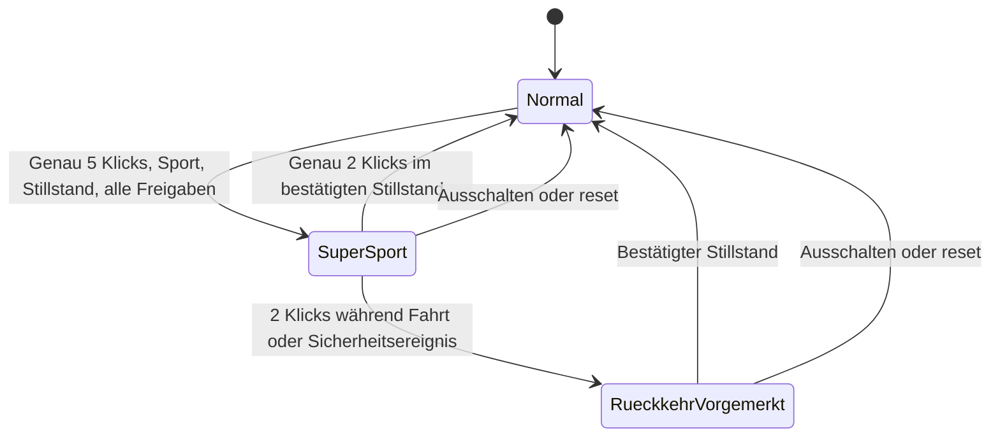

# Xiaomi Electric Scooter 5 Pro: SuperSport Mode (SSM)

Stand: 14. Oktober 2026. Untersuchte Codebasis: `95a8f339787a1fb6486554d61b573b8e2b688c53`.
Zielgerät laut Auftrag: `xiaomi.scooter.5pro`, Schweizer Ausführung,
MCU `0007`, BLE `2.7.0_0015`.

**Entwicklungsstufe 3 — Simulation erfolgreich.** Die Zustandsmaschine,
schreibgeschützte Originalprüfung, Export-Sperre, Offline-Demo und Tests sind
implementiert. Ein ausführbarer SSM-Firmware-Patch und die elektrische
Ansteuerung aller drei Symbole sind **nicht implementiert**. Es gibt keine
Hardwarefreigabe. Es wurde kein Scooter geflasht und keine flashbare
SSM-Datei erzeugt.

## A. Firmwareanalyse und Machbarkeit

### Quellen und Integrität

Die Streamlit-Seite war mit HTTP-Sitzungscookies erreichbar. Ihr öffentliches
Quellprojekt [argusblack/mi-fw-info](https://github.com/argusblack/mi-fw-info)
enthält einen Firmwarekatalog, keine Firmwarebinärdateien. Der geprüfte
[Katalogstand](https://github.com/argusblack/mi-fw-info/blob/ae9260764c863aede29bba8053c1986645e1e07f/mi.json)
ordnet beide Dateien ausdrücklich `xiaomi.scooter.5pro` zu. Die Oberfläche
bezeichnet den Hauptdownload als BLE-Firmware. Die Binärdateien wurden über
HTTPS direkt vom dort verlinkten Xiaomi-CDN `fk-res-abroad-cdn.home.mi.com`
bezogen, ausschliesslich ausserhalb dieses Git-Repositories gespeichert und
gegen die Katalog-MD5-Werte geprüft.

| Komponente | Katalogversion | Bytes | MD5, Download und Katalog identisch |
| --- | --- | ---: | --- |
| MCU | `0007` | 149504 | `aabaad0de541d7c79ca24d28c45ba097` |
| BLE | `2.7.0_0015` | 152552 | `1c76ba994d8326dca0203a424dc09ff6` |

SHA-256 der vollständig heruntergeladenen Dateien:

```text
MCU ddcd65400c4fbdb45cb4cdbec2e812026d7bc6cb755fd9dd0180800caed5f9b8
BLE 061d34cac06fb31d93ff8f47650cd09d61fa46e7a883b35c23f35cabff1e6df7
```

Diese Kombination aus Katalogzuordnung, Hersteller-CDN, Längen und Hashes ist
die Grundlage der Originalidentifikation. Sie ersetzt keine verifizierte
Herstellersignatur. Die Schweizer Region lässt sich daraus nicht bestätigen;
Regionseinstellungen können im Gerätezustand/NVM liegen. Insbesondere wird
aus dem Vorhandensein eines 25-km/h-Wertes im Code keine Schweizer
Originalgeschwindigkeit abgeleitet.

### Projektarchitektur

`bwpatcher/modules/mi5pro.py` erbt von `ES32Patcher` und dieser von
`CorePatcher`. Keystone assembliert ARM-Thumb-Anweisungen; Capstone liest
Thumb-Code in Little Endian. Das genaue Siliziummodell und alle
Peripherieregister wurden nicht identifiziert.

Die anderen Modellfamilien verwenden unter anderem `LKS32Patcher` und
`CoreN32Patcher`. Die N32-/LEQI-Pfade besitzen eigene Entpackungs-, XOR-,
CRC- und Ausgabeabläufe. Sie dürfen nicht auf die Mi5Pro-BLE-Datei übertragen
werden. Auch die UART-/Padding-Patches anderer Modelle sind keine Belege für
entsprechende Mi5Pro-Hooks. Insbesondere retuniert Ultra4 bei manchen
Speed-Patches auch Modusströme; diese Implementierung ist für den Auftrag
ungeeignet und wird nicht verwendet.

`detect.py` erkennt Modelle anhand der ersten `0x80` Bytes. Das Mi5Pro-Original
wird anhand der Kennung `000700010001` bei `0x22` korrekt erkannt. Diese
heuristische Modellerkennung prüft weder den gesamten Dateiinhalt noch dessen
Hardwarekompatibilität. Die neue Originalprüfung verlangt deshalb den exakten
SHA-256-Hash. Eine Datei mit nachgebautem Header und gültiger CRC wird nicht
als untersuchtes Original akzeptiert.

`utils.patch_firmware()` lädt die Patcherklasse dynamisch, führt die angeforderten
Methoden aus und liefert deren Daten zurück. Die bisherigen Ausgabewege sind
CLI-Datei und Streamlit-Download. Im älteren CLI-Pfad können gewöhnliche
Patchfehler gesammelt und dennoch Daten zurückgegeben werden. Die neue
SSM-Sperre liegt deshalb **vor** Instanziierung und erster Änderung und wird
auch im CLI ausdrücklich als Fehler behandelt.

Das ursprüngliche Repository enthält keine implementierte Mi5Pro-Tastengesten-
oder Segmentanzeigesteuerung. Es enthält auch keine belastbare BLE-Entpackung
für diese Datei. `find_pattern()` liefert den ersten Treffer und hat keine
allgemeine Eindeutigkeitsprüfung. Ein einzelner Pattern-Treffer wäre keine
ausreichende SSM-Freigabe.

### MCU-Struktur

Alle folgenden Offsets beziehen sich auf die **vollständige MCU-Downloaddatei**,
nicht auf Flashadressen. Sie gelten nur für den oben genannten SHA-256-Hash.

| Dateioffset / Bereich | Tatsächlicher Befund |
| --- | --- |
| `0x00000` | Big-Endian-Längenfeld `0x24000`; mit `0x800` Vorspann exakt Dateilänge `0x24800` |
| `0x00012` | ASCII-Paketfeld `0108`; dieses Feld ist nicht die Katalogversion `0007` |
| `0x00022` | Modellkennung `000700010001` |
| `0x00800` | Brightway-Marker `DEPRD5C` |
| `0x01000` | Erster ARM-Vektortabellenkandidat: Stack `0x20004e40`, Resetvektor `0x0800315d` |
| `0x19800` | Beginn des eingebetteten ES32-Headers |
| `0x19810` | ASCII-Kennung `SZMC-ES-ZM-0283M` |
| `0x19830` | ES32-CRC `3426` |
| `0x19880` | Zweiter Vektortabellenkandidat: Stack `0x20001ba8`, Resetvektor `0x000000d5`; Beginn des ES32-Codebereichs |
| `0x19880` bis exklusiv `0x24710` | `0xae90` Bytes ES32-Inhalt entsprechend dem inneren Längenfeld |
| `0x24710` bis EOF | 240 aufeinanderfolgende `0xff`-Bytes |

Das Paket enthält zwei ausführbare ARM-Bereiche. Ihre vollständige
Boot-/Prozessorzuordnung ist offen. Dass der Modus-/Speed-Code im zweiten
Bereich liegt, ist durch die existierenden ES32-Patches und Disassemblierung
belegt. Eine konkrete Flashbasis für eigene Einsprünge wurde nicht freigegeben.

**CRC-Besonderheit:** `CorePatcher._compute_checksum()` prüft im Bestand nur
`size <= len(data)`, nicht `offset + size <= len(data)`. Beim Mi5Pro-Paket liest
der vorhandene Ablauf dadurch ein überlanges Slice ab `0x19800`, das Python
am EOF abschneidet. Am Original stimmt dessen CRC `7487` mit dem Paketfeld
bei `0x0a` überein. Die CRC über den gesamten angekündigten BW-Nutzbereich
ab `0x800` wäre dagegen `7379` und passt nicht zu diesem Feld.

Der neue Audit bildet den beobachteten Bereich explizit als
`[0x19800, 0x24800)` mit Länge `0xb000` ab. Die innere CRC wird über
`[0x19880, 0x24710)` berechnet. Beide CRCs stimmen beim Original. Der bestehende
Checksum-Patch erzeugt beim unveränderten Original identische Bytes. Der
erste Codebereich wird von diesen beiden CRCs nicht vollständig abgedeckt;
die zusätzliche SHA-256-Prüfung umfasst deshalb immer die gesamte Datei.
Das beobachtete Layout wird nicht als universelle BW-Spezifikation ausgegeben.

### Fahrmodi und Geschwindigkeitsbegrenzung

Belegte Fundstellen im zweiten ARM-Bereich:

| Dateioffset | Befund / begrenzte Interpretation |
| --- | --- |
| `0x1d0c8` | Literalpool bei `0x1d2f4` enthält `0x20000229` |
| `0x1d0d6` | Lesen dieses Zustandsbytes; Vergleiche mit `0x0b`, `2`, `3` folgen |
| `0x1d136` | Pfad `0x0b` setzt den Wert `125`, konsistent mit ca. 6 km/h bei bestehendem Faktor 20,9 |
| `0x1d13a` | Pfad `2` lädt über `0x20000324`; Bezugspunkt des bisherigen Drive-Patches |
| `0x1d140` | Pfad `3` lädt über `0x20000326`; Bezugspunkt des bisherigen Sport-Patches |
| `0x1d0e8` | Vergleich/Begrenzung nach Auswahl des modusabhängigen Wertes |
| `0x203b2` | Lesen eines Eingabebytes bei `[r0 + 3]` |
| `0x203ca` | Dessen unteres Nibble wird über Literal bei `0x20488` nach `0x20000229` geschrieben |

Damit sind ein Moduszustand und dessen Zusammenhang mit einer Eingabestruktur
statisch belegt. Das obere Nibble desselben Eingabebytes wird separat nach
`0x20000228` geschrieben und auf `1..3` begrenzt. Seine genaue Bedeutung
wurde nicht bestätigt und wird ausdrücklich nicht verändert.

Die vorhandenen Methoden `speed_limit_sport()` und `speed_limit_drive()`
ersetzen zusätzlich den zehn Byte langen Bereich bei `0x1d0e8` durch NOPs,
sofern das Pattern vorhanden ist. Das ist eine zusätzliche Begrenzungsprüfung.
Ihre vollständige Bedeutung und Sicherheitswirkung sind nicht geklärt. Die
Methoden werden deshalb **nicht** als SSM-Bausteine aufgerufen. `sls=30` allein
erzeugt weder einen vierten Zustand noch eine geheime Aktivierung.

### Tasten, Display und Kommunikation

Die Routine bei `0x203b2` und die anschliessenden Bitfeldextraktionen bei
`0x204a0` zeigen die Übernahme gepackter Eingaben in Zustandsvariablen. Sie
belegen keinen direkten GPIO-/Rohflankenpfad der Einschalttaste. UART-Framing,
Nachrichtenrichtung, Schedulerkontext und Zuordnung zur BLE-/Dashboard-Seite
sind für diese Laufzeitnachricht noch nicht vollständig rekonstruiert.

Eine reine Auswertung bereits umgeschalteter Moduswerte reicht nicht aus,
um fünf Rohklicks zuverlässig zu erkennen: Die ersten beiden könnten bereits
den Originalmodus umschalten. Ein späterer Port braucht daher einen Hook
vor der Original-Doppelklickentscheidung oder einen nachgewiesenen Transport
der einzelnen Tastenereignisse. Dieser Hook wurde nicht identifiziert.

Die BLE-Datei enthält einen Vorspann mit `release` bei `0x67` und lesbare
DFU-/Flash-Diagnosetexte, unter anderem bei `0x2500`, `0x2520`, `0x2944` und
`0x9ac0`. Frühe Bereiche sind mit Thumb-Code vereinbar. Der hintere Bereich
ab `0xa000` hat eine gemessene Byte-Entropie von ca. 7,998 Bit/Byte. Hohe
Entropie allein beweist weder Verschlüsselung noch Kompression. Das vollständige
Containerformat und dessen interne Integritäts-/Signaturprüfung wurden nicht
rekonstruiert; die Zuordnung der BLE-Version beruht auf Katalog und Dateihash.

Es gibt bislang keinen nachgewiesenen LED-/LCD-Treiber, keine bestätigte
Segmentbelegung und kein belegtes Kommando für drei gleichzeitig leuchtende
Modussymbole. Die Hardware könnte dies erlauben; ihre Unmöglichkeit wurde
ebenfalls nicht bewiesen. Insbesondere dürfen Moduswerte nicht als unabhängige
Symbolbits interpretiert oder einfach verodert werden.

Der aktuelle Befund erlaubt **keinen belastbaren Firmware-Patch**. Die 240
Paddingbytes sind kein freigegebener Codebereich. Es fehlen geprüfte
RAM-Reservierung, Stack-/Register-/Interrupt-Verträge, Sprungreichweite,
Relokationen, Code-/Datenreferenzen und eine Integration beider beteiligten
Firmwareseiten. Es wurden deshalb keine Sprünge oder geratenen Befehle injiziert.

## B. Implementierung

### Dateien und Schnittstellen

| Datei | Änderung |
| --- | --- |
| `bwpatcher/ssm.py` | Unabhängige Referenzsimulation: `Timing`, `Inputs`, `ButtonRecognizer`, `SuperSportSimulation`, Zustände und Aktionen |
| `bwpatcher/ssm_firmware.py` | Schreibgeschützter Audit, strikte Originalidentifikation, begrenzte CRC-Bereiche und reproduzierbare Disassemblierung |
| `bwpatcher/ssm_demo.py` | Deterministische Offline-Demo einschliesslich Fahrt, vorgemerkter Deaktivierung und Neustart |
| `bwpatcher/utils.py` | SSM-Anforderungen vor erster Patchaktion abbrechen, auch gemischt mit vorhandenen Patches |
| `bwpatcher/__main__.py` | SSM-Fehler beendet CLI mit Code 1, ohne Ausgabedatei anzulegen/zu überschreiben; Hilfe ergänzt |
| `app.py` | Mi5Pro-Statusanzeige und standardmässig deaktivierte, gesperrte SSM-Checkbox |
| `tests/test_ssm.py` | Pegel-, Gesten-, Zustands-, Display- und Grenzfalltests |
| `tests/test_ssm_firmware.py` | Synthetische Struktur-/Exporttests und optionale Original-Regressionsprüfungen |
| `tests/test_ssm_ui.py` | Streamlit-Prüfungen und Demoablauf |
| `pyproject.toml` | Projektwurzel zum pytest-Importpfad ergänzt |
| `.gitignore` | Python-Tests versionierbar gemacht; proprietäre Fixture-Verzeichnisse weiterhin ausgeschlossen |
| `README.md`, `docs/supersport/` | Status, Benutzung und Analyse dokumentiert |

Die bestehenden Mi5Pro-Patchmethoden, Stromparameter und Checksum-Algorithmen
wurden nicht umgeschrieben. Das Modell liegt ausserhalb des dynamisch erfassten
Modulverzeichnisses und wird nicht versehentlich als Scooter-Modell angeboten.

### Gestenerkennung

Entwurfswerte, noch nicht am Dashboard kalibriert:

| Parameter | Wert |
| --- | ---: |
| Entprellung je Flanke | 30 ms |
| Ruhefenster nach dem letzten entprellten Loslassen | 350 ms |
| Maximale Sequenzdauer | 1800 ms |
| Langdruckschwelle | 800 ms |
| Bestätigter Stillstand vor Aktivierung / vorgemerkter Rückkehr | 500 ms |

Erst die Ruhephase entscheidet zwischen einem, zwei und fünf vollständigen
Klicks. Drei oder vier werden verworfen. Ein sechster Klick vor Fristablauf
verwirft die gesamte Folge; es gibt deshalb auch unmittelbar beim fünften
Loslassen noch keine Aktivierung. Ein bereits begonnener neuer Druck wird
während seiner Entprellung berücksichtigt. Eine neue rohe Druckflanke exakt
an der Frist beginnt eine neue Folge.

Das kostet bei Einzel- und Doppelklick grundsätzlich bis zu 350 ms zusätzliche
Wartezeit nach dem entprellten Loslassen. Ohne vorzeitige Nebenwirkungen lassen
sich identische Präfixe nicht früher eindeutig unterscheiden. Die normale
Bedienlatenz des echten Dashboards wurde nicht gemessen.

Langdruck verwirft laufende Klickfolgen und liefert einmal die Aktion zur
Original-Langdruckverarbeitung. Er schaltet die simulierte Hardware nicht selbst
aus. Moduswechsel bleiben ebenfalls Originalaktionen: Erst eine neue atomare
Eingabe bestätigt den tatsächlichen Modus. `next_stock_mode()` beschreibt nur
die im Auftrag genannte abstrakte Reihenfolge und keine numerischen MCU-Codes.

Aktivierung ist standardmässig deaktiviert. Bei ausdrücklich aktivierter
Simulation muss die gesamte Folge im normalen Sportmodus beginnen und gültig
bleiben. Voraussetzungen sind Betrieb, fehlerfreie bekannte Telemetrie,
entsperrter Scooter, exakt gemessene Geschwindigkeit null und losgelassener
Gashebel. Unbekannte Werte geben keine Aktivierung frei. Verlässt die Folge
diese Voraussetzungen, kann sie sich nicht unterwegs erneut scharfstellen.

Dashboardereignisse und widersprüchliche Tastenpegel am selben Zeitstempel
verwerfen die laufende Folge. Der spätere Adapter muss konkurrierende Ereignisse
vor der Auswertung in einem konsistenten Snapshot zusammenführen. Die Python-
Klassen sind keine interruptfähige Embedded-Implementierung. Abtastung und
Telemetriefrische müssen vom Aufrufer garantiert werden; in Tests und Demo
wird alle 10 ms abgetastet. Nicht beobachtete Flanken lassen sich nicht rekonstruieren.
Zeit läuft monoton; ein Uhrreset verlangt `reset()`, ein MCU-Timerüberlauf einen
gesonderten Portierungsvertrag.

Xiaomi dokumentiert bereits Gashebel plus fünf Tastendrücke zum Zurücksetzen
der Verbindung sowie eine andere gehaltene Kombination zum Werksreset.
Das Modell verhindert die SSM-Aktivierung mit betätigtem Gashebel. Es
implementiert die Hersteller-Resetlogik nicht. Ein echter Adapter muss solche
Originalkombinationen vor der SSM-Klassifizierung unverändert an ihren
Originalpfad geben; dafür reichen die derzeit belegten Hooks nicht aus.

### Zustand, Rückkehr und Anzeige



`speed_override_kmh` ist im Normalzustand `None`, im aktiven bzw. vorgemerkten
Zustand `30`. `None` delegiert an die Originalbegrenzung; die vorhandenen
Schweizer 20-km/h-Grenzen werden damit weder ausgelesen noch nachprogrammiert.
Die Simulation kann deren Vorhandensein am Gerät nicht nachweisen.

Die Rückkehr während der Fahrt wird vorgemerkt. Solange der Stillstand nicht
bestätigt ist, wird keine neue 20-km/h-Anforderung und kein Bremsbefehl erzeugt.
Fehler oder Telemetrieausfall verriegeln ebenfalls diese Rückkehrabsicht.
**Originale Fehlerabschaltung und Bremsfunktionen müssen jederzeit Vorrang
haben.** Ein vorhandener 30-km/h-Modellwert ist keine Erlaubnis, eine
Originalfehlerreaktion zu überstimmen. Dies muss beim späteren Port ausdrücklich
nachgewiesen werden. Nach `reset()` oder beobachtetem Ausschalten ist SSM aus;
es gibt keinerlei persistierten Aktivierungszustand.

`display(frame)` kopiert nur den abstrakten Schlüssel `mode_icons`. Im normalen
Betrieb enthält er das aktuelle Modussymbol, während SSM und vorgemerkter
Rückkehr alle drei. Wiederholte Aufrufe ändern die Symbolmenge nicht; es gibt
keinen Blinktimer. Geschwindigkeit, Batterie, Licht, Bluetooth, Fehler,
Warnungen und unbekannte Felder bleiben unverändert. Das ist eine logische
Projektion für die Simulation, kein Dashboardpaket und keine elektrische
Segmentsteuerung. Der spätere Port braucht ausserdem eine Bestätigung des
tatsächlichen Modus, bevor er eine erfolgreiche Umschaltung anzeigen darf.

### Ausführen

```bash
# Nach Installation der Projekt- und Testabhängigkeiten
python -m bwpatcher.ssm_demo

# Nur Lesen, keine Firmwareausgabe
python -m bwpatcher.ssm_firmware --mcu /lokal/mcu_0007.bin --ble /lokal/ble_2.7.0_0015.bin

# Fundstellen inkl. aufgelöster PC-relativer Literalpools
python -m bwpatcher.ssm_firmware --mcu /lokal/mcu_0007.bin --disassemble

# Ohne Originale: nur öffentliche, synthetische Tests
python -m pytest tests -q

# Mit lokal vorhandenen, exakt passenden Originalen
MI5PRO_FIRMWARE_DIR=/lokal/originale python -m pytest tests -q
```

Erwartete Dateinamen im lokalen Originalverzeichnis sind `mcu_0007.bin` und
`ble_2.7.0_0015.bin`. Der Audit-Exitcode 0 bedeutet identifizierte untersuchte
Originale, **keine Patchfreigabe**. `ssm_patch_available` bleibt immer `false`.
Weder `--experimental` noch der Web-Queryparameter entsperren SSM. Ein Versuch
wie `ssm` oder `sls=30,ssm,chk` wird vollständig vor der Patchausführung abgewiesen.

## C. Testergebnisse

Ausgeführt mit Python 3.12, Keystone 0.9.2, Capstone 4.0.2 und pytest 8;
Streamlit wurde mit `AppTest` ohne angeschlossene Hardware geprüft.
Die gemessene Anweisungsabdeckung der drei neuen SSM-Pythonmodule beträgt
zusammen 95 %, bei der Zustandsmaschine 98 %. Das ist keine Abdeckung der
Xiaomi-Firmware. Capstone 4.0.2 meldet eine bestehende `pkg_resources`-
Abkündigungswarnung; der geprüfte Lauf verwendet die im Projekt zugelassene
Setuptools-Version 80.9.0.

| Testumfang | Ergebnis |
| --- | --- |
| Vollständige Suite mit lokalem Originalverzeichnis | 114 bestanden, 0 fehlgeschlagen, 0 übersprungen |
| Öffentlicher Lauf ohne Originaldateien | 108 bestanden, 6 Originaltests übersprungen |
| Echte Hardwaretests | 0, mangels angeschlossener und freigegebener Testhardware nicht ausführbar |

Abgedeckt sind Einzel-, Doppel-, Fünffach-, Vierfach- und Sechsfachklick,
Entprellung, zu schnelle/zu langsame Eingaben, offene/überlange Folgen,
Langdruck, exakte Zeitgrenze, gleichzeitige/widersprüchliche Ereignisse und
verlorene Freigaben. Hinzu kommen alle drei normalen Moduswechsel, Aktivierung,
Rückkehr im Stillstand, vorgemerkte Rückkehr während Bewegung, Fehlerfälle,
Neustart sowie 6000 deterministische Zufallssamples mit Bewegung ohne Aktivierung.
Zwei zusätzliche Übergangstests stellen sicher, dass eine noch während SSM
begonnene Klickfolge nach der vorgemerkten Rückkehr weder einen weiteren
Originalmoduswechsel noch eine erneute Aktivierung auslöst.

Displaytests prüfen die abstrakten Symbole und unveränderte übrige Felder.
Die Firmwaretests prüfen ganze Hashes, manipulierte/trunkierte Dateien,
unzulässige CRC-Bereiche, CRCs mit bekanntem Testvektor, mehrdeutige Marker,
SSM-Exportverweigerung vor jeglicher Patcherinstanziierung und vorhandene
CLI-Ausgabedateien, die bei Fehlern unverändert bleiben müssen.

Die sechs optionalen Originaltests identifizieren beide Downloads, prüfen den
identischen Checksum-Lauf, reproduzieren Literalpoolreferenzen und testen
die bestehenden SLS-/SLD-Patches ausschliesslich im RAM. Dabei werden Länge,
CRCs und unveränderte Bytes ausserhalb der vorher beobachteten Patchstellen
geprüft. Diese Regressionstests sind **keine Sicherheitsfreigabe** der alten
Speed-Patches. Es gab im Ausgangsrepository keine eingecheckte Testsuite;
Hardwareverhalten und alle übrigen Modell-/Firmwarekombinationen wurden nicht
vollständig regressionsgeprüft.

Es wurden keine SSM-Einsprünge, keine SSM-Firmwareausführung, keine reale
Segmentanzeige, keine Fahrdynamik und keine realen Schutzreaktionen geprüft.
Die erfolgreiche Simulation darf deshalb nicht als Entwicklungsstufe 4
„Firmware-Patch offline validiert“ bezeichnet werden.

## D. Sicherheits- und Kompatibilitätsprüfung

Es existiert kein neuer Pfad, der Firmwarebytes für SSM verändert. Die
Originaldateien bleiben unverändert, SSM-Exportanforderungen brechen ab und
die Simulation besitzt keine Schnittstelle zu seriellen Geräten oder BLE.
Entsprechend wurden für SSM weder Strom-/Leistungs-/Beschleunigungswerte
noch Temperatur-, Batterie-, Unter-/Überspannungs-, Motor-, Rekuperations-,
Brems-, Fehler- oder Notabschaltparameter geändert. Es wurde keine
Integritäts-/Authentifizierungsprüfung entfernt.

Das beweist die Unverändertheit des aktuellen Forschungsstands, nicht die
Sicherheit einer zukünftigen Implementierung. Statische Fundstellen und
Modelltests können weder tatsächliche Strom-/Temperaturgrenzen noch
Bremswirkung unter Last beweisen. Ebenso sind die Erreichbarkeit von 30 km/h
bei Originalleistung und die Dauerhaltbarkeit ungeprüft. Die Implementierung
erhöht keine Leistung, um das Ziel zu erzwingen.

Xiaomi Home, Rekuperationsstufen niedrig/mittel/hoch, Kilometerstand,
Akkustand, Sperre, Bluetooth und Geräteinformationen wurden nicht auf echter
Hardware getestet. Xiaomi beschreibt die drei Rekuperationsstufen in seiner
FAQ; deren konkrete Speicher-/Protokollfelder wurden hier nicht freigegeben.
Der Konflikt mit den Original-Resetkombinationen ist vor einem Firmwareport
aufzulösen. Diese Modifikation erhält durch diesen Bericht keine Zulassung
für öffentliche Strassen in der Schweiz.

## E. Noch benötigte Nachweise und nächste Schritte

Die beiden im Auftrag genannten Originaldateien sind bereits beschafft;
für diesen Stand muss der Benutzer sie nicht nochmals bereitstellen.
Für eine Fortsetzung fehlen konkret:

1. **Tastenpfad:** Nachgewiesene GPIO-/Treiber-/Debounce-/Mehrfachklickroutine
   im Dashboard/BLE, vor der Original-Doppelklickaktion. Alternativ ein
   belegter Transport einzelner Flanken zum Controller samt Zeitbasis.
2. **Originalverhalten:** Zeitgestempelte passive Traces für Einzel-, Doppel-,
   Fünffach- und Langdruck, jeweils mit Modus, Geschwindigkeit, Gas, Bremse,
   Sperre und Fehlern. Die OEM-Resetkombinationen müssen unterscheidbar bleiben.
3. **Displaypfad:** Dashboard-/Platinenrevision, Segmenttreiber/Pinbelegung,
   Multiplexverfahren und mindestens ein nachweislich unabhängiger Zugriff auf
   Fussgänger-, D- und S-Symbol. Ein Foto und vorhandene Schaltungsunterlagen
   können die Zuordnung stützen; nötig ist letztlich ein elektrischer Nachweis
   ohne beeinträchtigte Warn-/Fehleranzeige.
4. **BLE-Paketformat:** Vollständige Segmentzuordnung, Integritätsprüfung und
   bei Bedarf eine legitim lesbare Laufzeit-/Flash-Abbildung der exakt
   passenden Dashboardfirmware. Der bestehende OTA-Download ist vorhanden,
   aber nicht vollständig dekodiert. Sicherheitsprüfungen dürfen nicht
   zugunsten einer Integration entfernt werden.
5. **Controllervertrag:** Belegte Geschwindigkeits-/Fehler-/Sperrsignale,
   Stillstandsdefinition, Telemetriefrische, maximale Latenzen, NVM-/Region-
   Zuordnung und eine Umschaltstelle, die keine Originalschutzlogik umgeht.
6. **Portierungsnachweis:** Zulässiger Flash-/RAM-Platz, Startupinitialisierung,
   gesicherte Hooks, Register-/Stackverträge, Code-/Datenreferenzen,
   Worst-Case-Laufzeit und reproduzierbare Prüfung jeder geänderten Bytefolge.
7. **Nach einem getrennten, ausdrücklich autorisierten Hardwaretestaufbau:**
   Zuerst Tasten-/Displayintegration ohne Antrieb, danach Strom-/Brems-/Fehler-
   und App-Kompatibilität, zuletzt kontrollierte Lasttests. Ein Fahrtest allein
   wäre kein Nachweis für sämtliche Schutzmechanismen. Es wird nicht automatisch
   geflasht.

Sollte sich eine gleichzeitige Ansteuerung aller drei Symbole als technisch
unmöglich erweisen, käme eine separat nachgewiesene vorhandene Anzeige infrage.
Eine solche Alternative wurde noch nicht ausgewählt, da der Segmenttreiber
und die unbeeinträchtigte Fehleranzeige zuvor geklärt werden müssen.

## F. Entwicklungsstatus und Quellen

| Stufe | Erreicht? |
| --- | --- |
| 1. Theoretisches Konzept | Ja |
| 2. Quellcode implementiert | Ja, Referenzsimulation und Forschungswerkzeuge |
| 3. Simulation erfolgreich | **Ja, aktueller Gesamtstand** |
| 4. Firmware-Patch offline validiert | Nein; die Prüfung bestehender Patches ist kein SSM-Patch |
| 5. Auf echter Hardware geprüft | Nein |

Änderungsziel ist ausschliesslich der Fork
[Domangy/bw-patcher](https://github.com/Domangy/bw-patcher), Branch
`codex/mi5pro-ssm-research`. Am Originalrepository wurden keine Änderungen
vorgenommen und kein Pull Request eröffnet. Der Forschungsstand liegt als
[Draft-PR #1](https://github.com/Domangy/bw-patcher/pull/1) gegen `master` im Fork vor.

Quellen für nachprüfbare Zuordnung und Originalbedienung:

- [Firmwarekatalog, fixierter Commit](https://github.com/argusblack/mi-fw-info/blob/ae9260764c863aede29bba8053c1986645e1e07f/mi.json)
- [Katalogoberfläche: Benennung des BLE-Downloads](https://github.com/argusblack/mi-fw-info/blob/ae9260764c863aede29bba8053c1986645e1e07f/static/app.js)
- [Mi5Pro-Patcher der untersuchten Fork-Codebasis](https://github.com/Domangy/bw-patcher/blob/95a8f339787a1fb6486554d61b573b8e2b688c53/bwpatcher/modules/mi5pro.py)
- [ES32-Checksum-Pfad derselben Codebasis](https://github.com/Domangy/bw-patcher/blob/95a8f339787a1fb6486554d61b573b8e2b688c53/bwpatcher/core_es32.py)
- [Xiaomi-FAQ: Originalkombinationen und Rekuperation](https://www.mi.com/uk/support/faq/details/KA-504123/)

Firmwarebinärdateien und proprietäre Dumps sind nicht Bestandteil dieses
Berichts, der Tests oder des Pull Requests.
